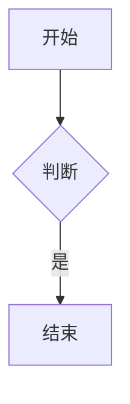
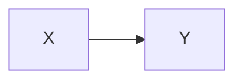

<!-- EX01 脚注：单行、多行、复引、内联、CJK 标签 -->

正文脚注甲[^fn-a]与脚注乙[^fn-b]，脚注甲复引[^fn-a]；内联脚注^[这是内联脚注正文]。

[^fn-a]: 单行脚注正文甲。
[^fn-b]: 多行脚注乙首行
    缩进续行属于脚注乙。

<!-- EX02 emoji 短码与快捷 -->

短码 :fire: 与 :tada: 与 :+1: 与 :100: 与 :heart_eyes: 齐活；快捷 :) 与 :-) 与 ;) 与 <3。

未收录短码 :not_in_table: 与 :smile_cat: 保持字面。行内码 `:fire:` 保持字面。

<!-- EX03 GFM Alert 五类与不识别形态 -->

> [!NOTE]
> 备注类正文

> [!TIP]
> 提示类正文

> [!IMPORTANT]
> 重要类正文

> [!WARNING]
> 警告类正文

> [!CAUTION]
> 危险类正文

> [!note]
> 小写不识别

> [!UNKNOWN]
> 未知类型不识别

> 普通引用不识别
> [!NOTE] 不在首行

<!-- EX04 KaTeX 三定界符与金额红线 -->

行内拉丁 \(x_i^2 + y_i\) 与方括号显示 \[\int_0^1 x\,dx = \frac{1}{2}\]。

$$E = mc^2$$

多行显示式：
$$
\begin{aligned}
x &= 1 \\
y &= 2 + x
\end{aligned}
$$

中文伪公式 \(中文混排 = 甲 + 乙\) 与块级 $$中文公式块 = 丙 + 丁$$。

未闭合 $$ 到行尾保持字面。

金额红线：预算 $1,000 与 $2,000 合计 ¥12,345.67，裸 $x$ 与 $ y $ 都不是公式。

<!-- EX05 Mermaid 围栏 -->





<!-- EX06 锚点：重复标题与 CJK/英文 slug -->

## 重复标题
## 重复标题
## 含标点、空格的 标题！（感叹）
## English Heading With Spaces

[跳到重复标题](#重复标题) 与 [跳到英文](#english-heading-with-spaces)。

<!-- EX07 pangu 中西插空 -->

使用TypeScript编写代码，2026年Q3财报与AI大模型GPU集群评测。

金额 ¥12,345.67 与 $1,000 与欧元€99 紧贴数字不插空。

行内码 `中文code混排` 不插空；[链接文字中文abc](https://pangu.example.com) 链接内不插空。

<!-- EX08 tok-break 长 token -->

短 token transform_request 与长 token transform_request_id_20260921 需断行。

下划线与连字符 super_long_identifier_name-abcdefghij 需断行。

金额 1,234,567.89 不应被包裹。

<!-- EX09 hljs 语言集（20 注册语言 + 别名 + 未注册） -->

```ts
const n: number = 1;
```

```js
const m = 2;
```

```python
x = 1
```

```rust
fn main() { println!("hi"); }
```

```sql
SELECT 1 FROM t;
```

```json
{"a": 1}
```

```yaml
a: 1
```

```bash
echo hi
```

```go
package main
```

```java
class A {}
```

```cpp
int main() { return 0; }
```

```c
int main() { return 0; }
```

```csharp
class A {}
```

```kotlin
fun main() {}
```

```php
<?php echo 1; ?>
```

```ini
[sec]
k=1
```

```diff
+added
-removed
```

```html
<div>x</div>
```

```css
.a { color: red; }
```

```markdown
# title
```

```unknownlang
未注册语言纯转义 <a> & **粗**
```